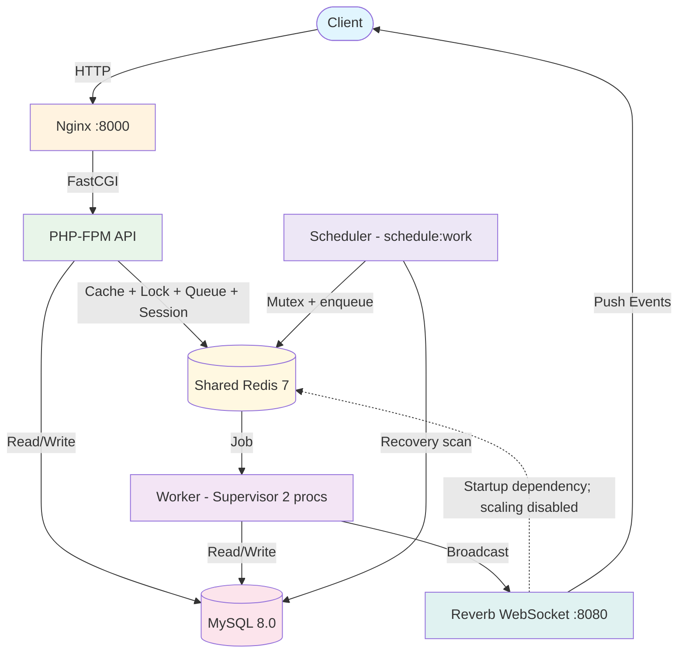
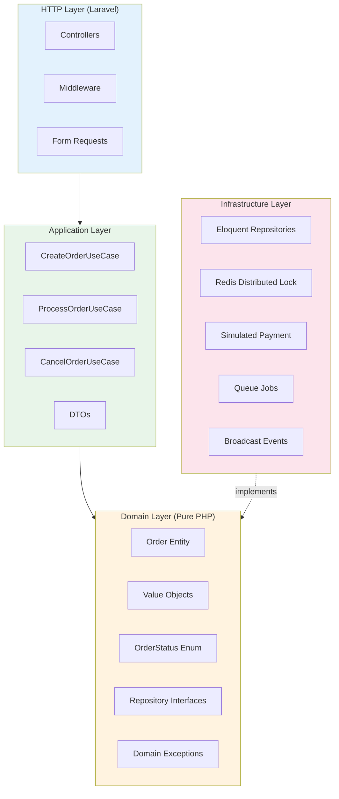
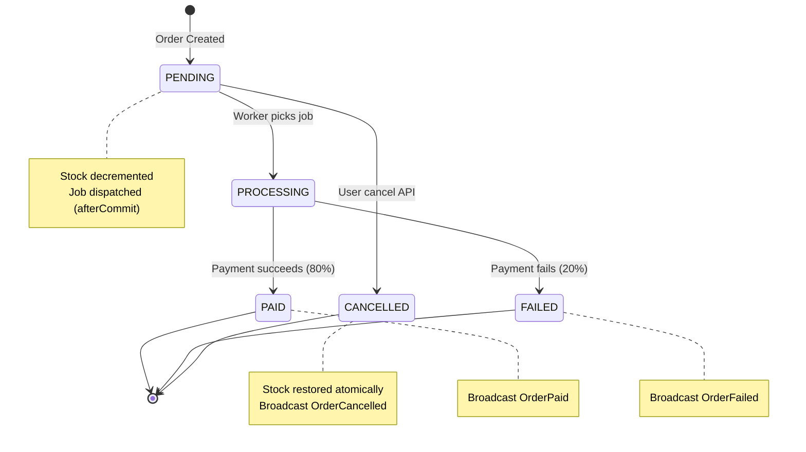
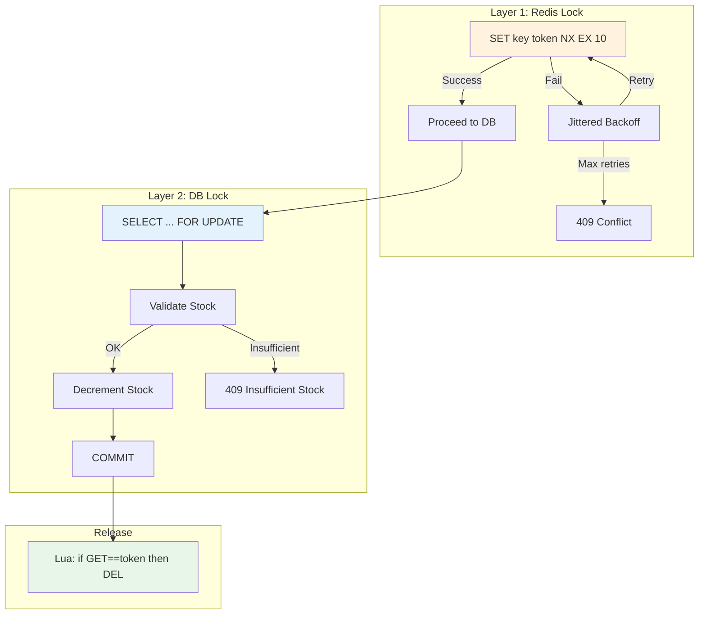
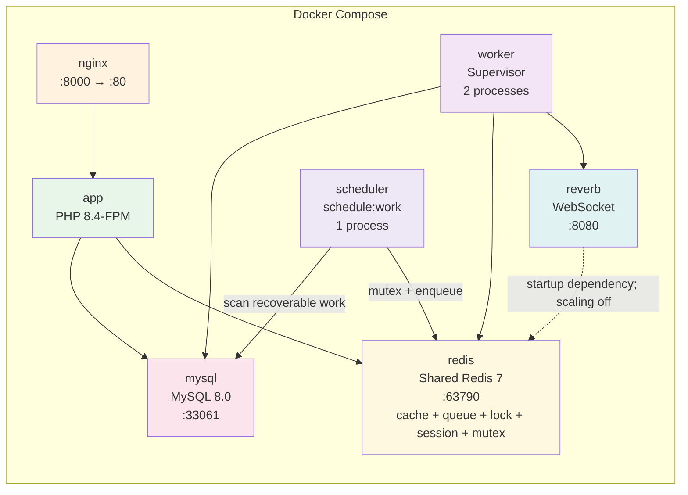
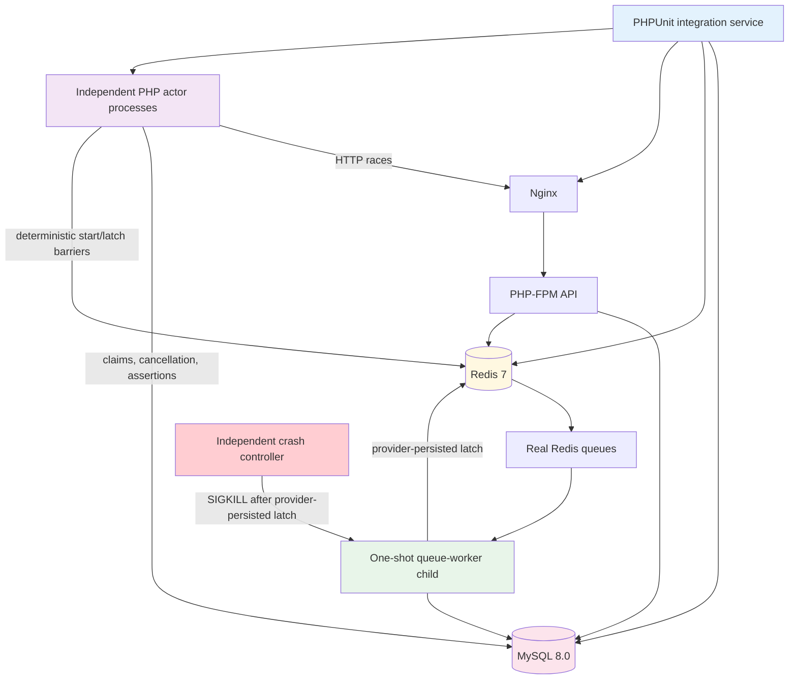
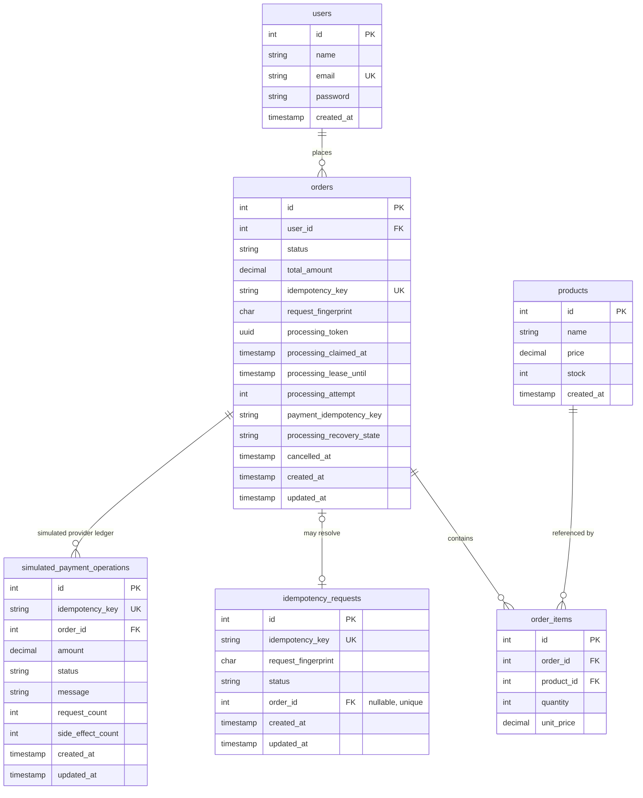
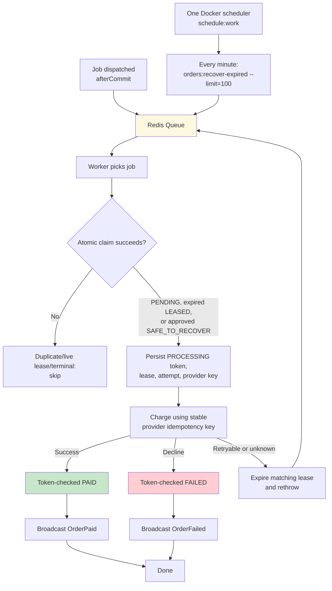
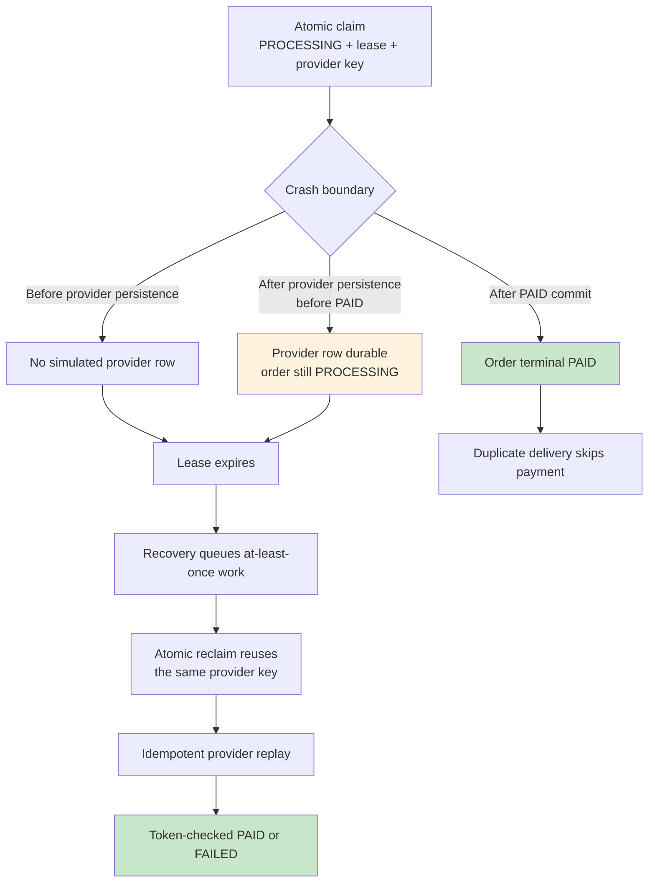
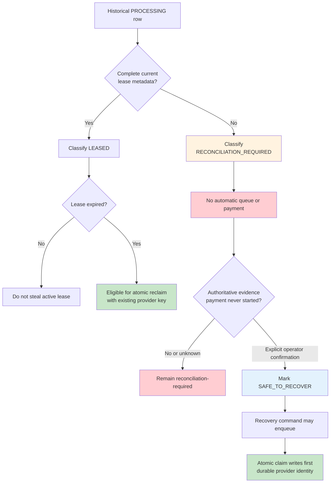

# Production-Inspired Architecture

> Detailed architecture diagrams for the Distributed Order Processing System.
> These diagrams supplement the [README](../README.md) with visual references.
> They describe a production-inspired showcase with a simulated payment provider,
> not a production deployment or a live-payment safety claim.

---

## System Architecture Overview



---

## Clean Architecture Layers



**Dependency Rule**: All arrows point inward. Infrastructure implements Domain interfaces, never the reverse.

---

## Order Lifecycle State Machine



---

## Atomic Cancellation Flow

```mermaid
sequenceDiagram
    participant C as Cancel caller(s)
    participant DB as MySQL
    participant WS as Reverb

    C->>DB: BEGIN; UPDATE order to CANCELLED WHERE status=PENDING
    alt Exactly one conditional-update winner
        C->>DB: Lock/load order and items
        C->>DB: Increment inventory for each item
        DB-->>C: COMMIT status + all inventory increments
        C->>WS: Broadcast OrderCancelled after commit
    else Order already CANCELLED
        DB-->>C: 200 idempotent replay; no inventory increment
    else PROCESSING, PAID, or FAILED won first
        DB-->>C: 422 INVALID_TRANSITION; no inventory increment
    end
```

Cancellation and worker processing race on conditional updates to the same order
row. If cancellation wins, the worker claim skips the terminal order. If the
worker changes `PENDING` to `PROCESSING` first, cancellation is rejected. Any
inventory-restoration exception rolls the cancellation transaction back.

---

## Request Flow (Create Order)

```mermaid
sequenceDiagram
    participant C as Client
    participant N as Nginx
    participant A as PHP-FPM (API)
    participant R as Redis
    participant DB as MySQL
    participant Q as Queue (Redis)
    participant W as Worker
    participant WS as Reverb (WebSocket)

    C->>N: POST /api/orders
    N->>A: Forward (FastCGI)
    A->>A: Validate (FormRequest)
    A->>A: Canonicalize payload + SHA-256 fingerprint
    A->>DB: Fast lookup idempotency_requests

    alt Existing durable request
        A->>A: Compare fingerprint + load completed order
        A-->>C: 200 replay or 409 conflict
    else No durable request
        A->>DB: Fast lookup legacy/external order unique key
        alt Legacy order exists
            A->>A: Compare stored/derived fingerprint
            A-->>C: 200 replay or 409 conflict
        else No existing result
            rect rgb(230, 245, 255)
                Note over A,DB: Database-authoritative transaction
                A->>DB: INSERT IGNORE idempotency reservation
                A->>DB: SELECT reservation FOR UPDATE
                A->>A: Compare fingerprint
                alt Caller owns reservation
                    A->>R: Acquire sorted product locks (SET NX EX)
                    A->>DB: SELECT products FOR UPDATE
                    A->>A: Validate stock + calculate server total
                    A->>DB: Decrement stock; insert order + items
                    A->>DB: Complete reservation with order_id
                    DB-->>A: COMMIT
                else Concurrent caller completed reservation
                    A->>DB: Load the completed order
                end
            end

            alt Transaction winner
                A->>Q: dispatch(ProcessOrderJob)->afterCommit()
                A->>R: Release held locks with token-checked Lua
                A-->>C: 201 Created
            else Exact concurrent replay
                A-->>C: 200 OK + Idempotency-Replayed: true
            else Fingerprint conflict
                A-->>C: 409 IDEMPOTENCY_CONFLICT
            end
        end
    end

    rect rgb(245, 230, 255)
        Note over W,WS: Async Processing
        Q->>W: Deliver job (at least once)
        W->>DB: Atomic conditional claim + token + lease
        W->>W: Charge with stable provider idempotency key
        alt Payment Success (80%)
            W->>DB: Token-checked UPDATE → PAID
            W->>WS: Broadcast OrderPaid
        else Payment Failure (20%)
            W->>DB: Token-checked UPDATE → FAILED
            W->>WS: Broadcast OrderFailed
        else Retryable/ambiguous provider error
            W->>DB: Expire matching lease
            W->>Q: Retry with the same provider key
        end
        WS-->>C: Push event (configured private channel)
    end
```

The `orders.idempotency_key` unique index remains a legacy/external-writer
backstop. Its duplicate-key recovery path compares the fingerprint and returns a
replay rather than reporting a second creation. Only the transaction winner
dispatches work or runs creation handlers.

The channel callback checks an authenticated user's ID, but API authentication
and an end-to-end broadcast-authentication flow are not implemented or proven in
this milestone. Broadcast delivery also remains outside the database transaction.

---

## Distributed Locking Strategy



---

## Docker Infrastructure



---

## Real Integration Verification Topology



The isolated profile refuses SQLite, array cache, synchronous queues, and the
in-memory lock implementation. HTTP contention goes through nginx and PHP-FPM;
actor processes synchronize with expiring Redis barriers instead of sequential
loops. Queue tests consume real Redis jobs, and the hard-crash fixture uses a
separate controller process to stop the worker at a deterministic simulated-
provider boundary. Broadcasts use the log driver in this profile, so the suite
does not prove authenticated end-to-end WebSocket clients.

---

## Database Schema (ER Diagram)



`idempotency_requests` is the create-request authority. The unique
`orders.idempotency_key` remains a defensive backstop for legacy/external
writers. `simulated_payment_operations` represents a local provider contract;
it is not evidence about a real payment gateway.

---

## Queue & Worker Pipeline



### Scheduled Recovery Runtime

The default Compose runtime contains exactly one dedicated `scheduler` service.
It runs `php /var/www/artisan schedule:work`, invokes
`orders:recover-expired --limit=100` every minute, and uses Laravel's existing
`withoutOverlapping(5)` mutex. Command output, including the number requeued,
is sent to stdout and is visible with `docker compose logs scheduler`.

The isolated Docker verification demonstrates the scheduler executing against
real MySQL and Redis, queueing an expired lease while no worker is running, and
one real worker later completing it through the simulated provider with the same
durable payment identity.

This is production-inspired runtime wiring, with explicit limits:

- `restart: unless-stopped` restarts an unexpectedly exited scheduler process;
- unavailable MySQL or Redis can fail a tick, which is reported in the logs;
- while workers remain down, later ticks can enqueue duplicate recovery attempts
  and grow the backlog;
- database claims and provider idempotency protect business side effects, not
  queue growth;
- the default showcase does not run multiple scheduler instances.

The current shared, eviction-prone Redis and the commit-to-queue gap remain
documented limitations for later milestones. This verification does not claim
exactly-once execution, guaranteed recovery, or arbitrary crash safety.

### Payment Crash Boundaries



The Milestone 2A.4 hard-crash test uses a real queue-worker child process and an
explicit Redis latch inside the simulated provider. The latch is published only
after the provider ledger is durable; a second application process then sends
`SIGKILL` before control returns to the order use case. The order remains
`PROCESSING`, recovery later reuses its stored provider identity, and the
simulated provider records two requests but one idempotent side effect.

A timeout expires the matching current `LEASED` claim, so the scheduler may
requeue it and the simulated provider's idempotent replay can return the durable
result under the same identity. This is not the legacy
`RECONCILIATION_REQUIRED` marker. A real provider integration must define an
authoritative lookup or equivalent idempotent-replay contract before enabling
that automatic path; the repository never invents an external outcome. A
durable simulated decline completes `FAILED` and is not retried, while the
demonstrated pre-acceptance failure expires the lease and may retry with the same
identity. Once `PAID` is durable, payment delivery is terminal, but
notification/handler delivery is not covered by a transactional outbox. These
are production-inspired patterns demonstrated at controlled boundaries, not
arbitrary crash safety or a live payment guarantee.

### Legacy `PROCESSING` Reconciliation



This is a production-inspired reconciliation policy demonstrated with a
simulated payment provider. The idempotent backfill classifies only; it never
fabricates a token, lease, attempt, provider key, or payment outcome. The
`--confirmed-no-payment` operator flag represents evidence obtained outside this
showcase. Known paid/declined outcomes and unknown outcomes are intentionally not
replayed. The real-MySQL/Redis integration test is a reproducible concurrency and
recovery demonstration; it does not establish fitness for live payment operations
or recovery across every possible crash boundary.

---

*These diagrams are rendered natively on GitHub. For local viewing, use a Mermaid-compatible Markdown viewer or [mermaid.live](https://mermaid.live).*
